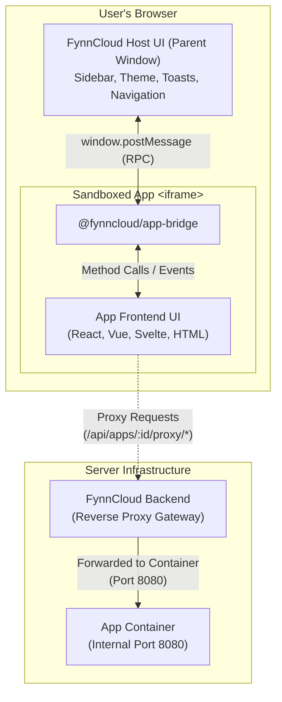

# @fynncloud/app-bridge

The official **frontend browser library** for building [FynnCloud](https://fynncloud.ch) applications.

FynnCloud runs web applications inside a sandboxed `<iframe>` alongside the main FynnCloud UI. `@fynncloud/app-bridge` facilitates bidirectional communication between your app's frontend and the FynnCloud host window via `window.postMessage`.

> [!IMPORTANT]
> **This is a client-side (browser) UI library.**
> - It runs exclusively in the browser inside your app's `<iframe>`.
> - It does **not** run on server backends (Node.js servers, Python, Go, etc.).
> - For backend services, communication with FynnCloud happens over standard HTTP (via reverse proxy headers, webhooks, and REST APIs). A dedicated backend API client (`@fynncloud/api-client`) will be provided for server-side tasks.

---

## Architecture Overview



---

## Installation

### With a Modern Bundler (Vite, Next.js, Nuxt, React, Vue, Svelte)

Install the package via npm:

```bash
npm install @fynncloud/app-bridge
```

Import and initialize the singleton instance:

```ts
import { fynncloud } from '@fynncloud/app-bridge';

// Call init() once when your app loads
fynncloud.init();
```

Full TypeScript declarations are bundled with the package.

### Without a Bundler (Plain HTML, Vanilla JS, Django/Flask/PHP templates)

Load the pre-bundled UMD/IIFE script from a CDN or self-host it from your container:

```html
<!-- Load the App Bridge script -->
<script src="https://cdn.jsdelivr.net/npm/@fynncloud/app-bridge@0.1/dist/app-bridge.global.js"></script>

<script>
  // window.fynncloud is automatically available
  window.fynncloud.init();
</script>
```

> [!TIP]
> Pin the version matching your target App API version (e.g. `@0.1`). If you cannot rely on an external CDN, include `dist/app-bridge.global.js` in your app's static assets.

---

## Compatibility with FynnCloud App API

The `@fynncloud/app-bridge` package version directly tracks the **FynnCloud App API version**:

- **Bridge `0.1.x`** targets **App API `0.1.x`**.
- Patch releases (`0.1.1`, `0.1.2`, ...) deliver fixes and improvements without breaking changes.
- When FynnCloud introduces a new App API version (e.g. `0.2.0`), a corresponding `@fynncloud/app-bridge` version (`0.2.0`) is released.

In your app's `manifest.json`, declare your supported App API version range:

```json
"compatibility": {
  "api_version": ">=0.1.0 <0.2.0"
}
```

The minimum API version declared in `compatibility.api_version` must be at least the API version of the bridge package you use.

---

## Quick Start (Frontend UI)

```ts
import { fynncloud } from '@fynncloud/app-bridge';

fynncloud.init();

console.log('App ID:', fynncloud.context.appId);
console.log('Active Theme:', fynncloud.context.theme);         // 'dark' | 'light'
console.log('Primary Brand Color:', fynncloud.context.primaryColor); // e.g. '#6366f1'
console.log('User Locale:', fynncloud.context.locale);         // e.g. 'en', 'de'
console.log('App API Version:', fynncloud.context.apiVersion); // e.g. '0.1.0'

if (fynncloud.context.user) {
  console.log('User ID:', fynncloud.context.user.id);
  console.log('User Email:', fynncloud.context.user.email);
}

fynncloud.on('themeChange', ({ theme }) => {
  console.log('Theme changed to:', theme);
});

fynncloud.on('tokenRefresh', (newToken) => {
  console.log('Received fresh scoped JWT token:', newToken);
});

fynncloud.on('tokenError', ({ reason }) => {
  console.warn('Session expired or could not be renewed:', reason);
});

await fynncloud.showToast('Project created successfully!', 'success');
```

---

## Core Features & Guides

### 1. Theme Synchronization

FynnCloud automatically informs the bridge when the host theme changes.

By default, `@fynncloud/app-bridge` automatically adds/removes the `dark` and `light` classes on the root `<html>` element (`document.documentElement`), allowing Tailwind CSS (`darkMode: 'class'`) and CSS variables to work out-of-the-box without extra code:

```css
/* Custom CSS example */
:root.dark {
  background-color: #0f172a;
  color: #f8fafc;
}
:root.light {
  background-color: #ffffff;
  color: #0f172a;
}
```

To manually handle theme changes in your UI state (e.g. Pinia, Redux, Zustand):

```ts
fynncloud.on('themeChange', ({ theme }) => {
  myThemeStore.setTheme(theme);
});
```

---

### 2. URL & Sidebar Route Synchronization

When an app defines a navigation sidebar in `manifest.json` under `ui.sidebar`:

```json
{
  "ui": {
    "launcher": true,
    "entrypoint": "/",
    "sidebar": [
      {
        "id": "dashboard",
        "label": "Dashboard",
        "icon": "heroicons:squares-2x2-solid",
        "position": "top_nav",
        "target": "/"
      },
      {
        "id": "settings",
        "label": "Settings",
        "icon": "heroicons:cog-6-tooth-solid",
        "position": "bottom_nav",
        "target": "/settings"
      }
    ]
  }
}
```

- When the user clicks a sidebar entry, the host sets the iframe path.
- When your frontend navigates internally (e.g. using `vue-router` or `react-router`), `fynncloud.init()` hooks into browser `popstate` events to notify the host of the current path.
- The host left navigation bar automatically highlights the active sidebar item **without reloading the iframe**.

---

### 3. Authentication & Scoped API Calls

When your frontend needs to make direct HTTP calls to FynnCloud's REST API (e.g. to `/api/files` or `/api/user/me`):

1. Request the required scopes in `manifest.json` (e.g. `"permissions": ["files:all:read"]`).
2. Read the short-lived scoped JWT from `fynncloud.context.token`.
3. Pass it as a standard Bearer token in the `Authorization` header:

```ts
async function loadFiles() {
  const token = fynncloud.context.token;
  if (!token) throw new Error('Not authenticated');

  const response = await fetch('/api/files', {
    headers: {
      'Authorization': `Bearer ${token}`
    }
  });
  return await response.json();
}
```

#### Token Refresh Lifecycle
- Scoped tokens are valid for **15 minutes**.
- The FynnCloud host automatically refreshes the token in the background and pushes the new token to your app via the `tokenRefresh` event.
- `fynncloud.context.token` is updated automatically.
- If the user's host session terminates, the `tokenError` event is fired.

---

### 4. File Actions (Context Menu Integration)

If your app registers file hooks in `manifest.json` (e.g. opening images or editing text files):

```json
"hooks": {
  "file_actions": [
    {
      "id": "edit-markdown",
      "label": "Edit Markdown",
      "extensions": [".md", ".markdown"],
      "icon": "heroicons:pencil-square-solid",
      "mode": "navigate",
      "target": "/editor"
    }
  ]
}
```

When opened via the file context menu, access the target file in your UI:

```ts
// Initial launch context
if (fynncloud.context.fileId) {
  loadFile(fynncloud.context.fileId, fynncloud.context.fileName);
}

// Or listen if the app is already open when the user selects another file
fynncloud.on('fileAction', (payload) => {
  loadFile(payload.fileId, payload.fileName);
});
```

---

## RPC Methods Reference

All RPC methods return a Promise.

### `showToast(message, type?, duration?)`
Displays a native FynnCloud toast notification in the host window:

```ts
await fynncloud.showToast('Changes saved', 'success', 3000);
// type can be: 'info' | 'success' | 'warning' | 'error' (default: 'info')
// duration in milliseconds (default: 3000)
```

### `navigate(path, external?)`
Navigates the host window:

```ts
// Internal host navigation (navigates host to /files)
await fynncloud.navigate('/files');

// External navigation (opens link in a new browser tab)
await fynncloud.navigate('https://docs.fynncloud.ch', true);
```

### `close()`
Requests the host to close the modal or navigate away from the app view:

```ts
await fynncloud.close();
```

### `ping()`
Performs a health check round-trip to the host. Returns `{ pong: true, timestamp, apiVersion }`:

```ts
const { apiVersion } = await fynncloud.ping();
console.log('Host App API version:', apiVersion);
```

### `storage` (Key-Value Storage)
Persists client-side application settings in the host database, scoped per app and per user:

```ts
// Set a key (serializable objects, arrays, strings, numbers)
await fynncloud.storage.set('user_preferences', { viewMode: 'grid', zoom: 1.2 });

// Get a key
const prefs = await fynncloud.storage.get('user_preferences');

// Delete a key
await fynncloud.storage.delete('user_preferences');
```

---

## Frontend vs. Backend Responsibilities

| Responsibility | Handled By | How it Works |
| :--- | :--- | :--- |
| **Iframe UI & Host Events** | `@fynncloud/app-bridge` | `window.postMessage` RPC between host window and app iframe |
| **Theme & Sidebar Sync** | `@fynncloud/app-bridge` | Dynamic CSS classes (`dark`/`light`) and route history sync |
| **Native Host Toasts** | `@fynncloud/app-bridge` | Calls `fynncloud.showToast()` to show host notification |
| **Browser REST Calls** | Your Frontend Code | `fetch('/api/...')` with `Bearer ${fynncloud.context.token}` |
| **Backend REST & DB** | Your Backend Container (e.g. Node, Python, Go) | Docker container on port 8080 reading `X-Forwarded-*` proxy headers |
| **Backend API Client** | `@fynncloud/api-client` *(future)* | Server-side HTTP client for webhook verification and REST API automation |

---

## License

MIT © [FynnCloud](https://fynncloud.ch)
